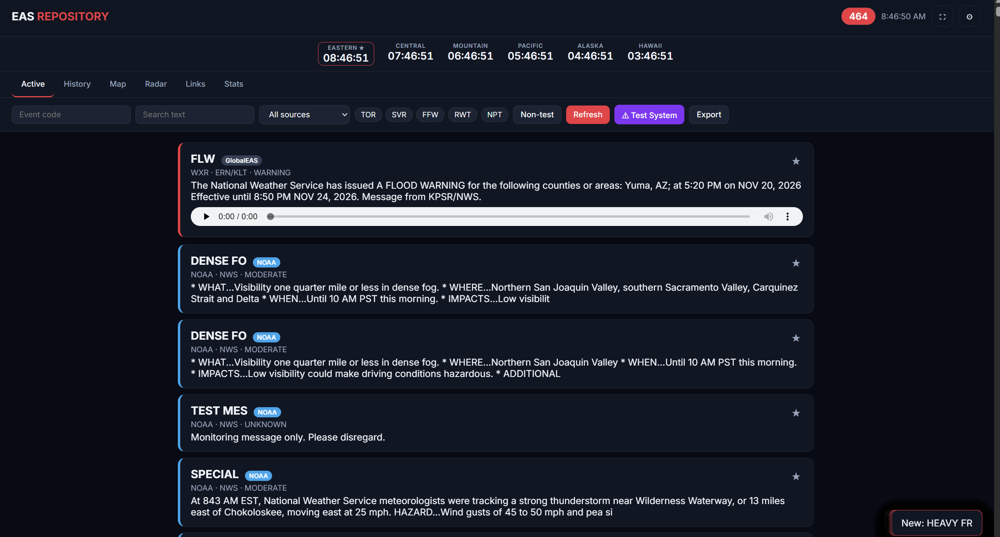
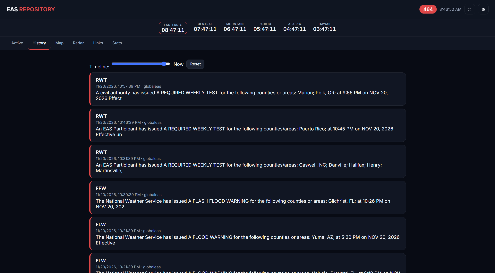
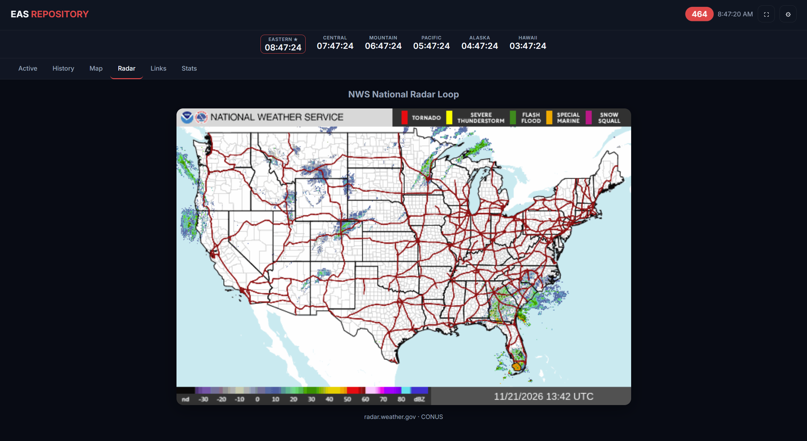

# EAS Repository

[](https://github.com/your-github-user/eas-repository/actions/workflows/ci.yml)
[](LICENSE)
[](https://www.python.org/)
[](#requirements)
[](CHANGELOG.md)

A local, open-source dashboard for monitoring U.S. Emergency Alert System (EAS) and NOAA alerts.

It runs on your own machine, proxies the public GWES Central Alert Repository API and NOAA CAP
feeds, and shows them in one clean interface with filtering, notifications, history, and more.

**Status:** v1.0.0-beta. Core features work; some polish and edge-case handling may still
improve. Project name is temporary pending final confirmation.

## Screenshots

**Active alerts**



**Alert history**



**Radar**



## Features

**Alerts**
- Live alerts from the GWES Central Alert Repository and NOAA CAP feeds
- Filter by source, event code, or free text; non-test toggle; pin alerts
- Alert history with a timeline scrubber, plus JSON export

**Notifications**
- Desktop notifications, optional sound, and a 5-minute mute
- Simple keyword rules (e.g. `TOR|SVR|FFW in my area`, `Any extreme`)
- Local alerting for your counties (FIPS codes)

**Views**
- National NWS radar loop
- Approximate alert map (Leaflet)
- Live clocks for U.S. time zones, stats, and a curated links tab

**App**
- 13 persisted themes, compact mode, and auto-refresh (15s / 30s / 60s / off)
- Export/import settings packs (including rules)
- Offline/cached mode with a clear last-update status
- Installable PWA manifest
- 100% local: no accounts or API keys required

## Requirements

- Python 3.8 or newer (standard library only; nothing to `pip install`)
- An internet connection
- A modern browser

## Quick start

```bash
git clone https://github.com/your-github-user/eas-repository.git
cd eas-repository
python eas_monitor.py
```

Open <http://localhost:8080> and log in with the default password `eas`. Change it under
**Settings → Change password**.

Press <kbd>Ctrl</kbd>+<kbd>C</kbd> in the terminal to stop the server.

## Configuration

| Setting | Where | Default |
| --- | --- | --- |
| Port | `EAS_PORT` environment variable (falls back to `PORT`) | `8080` |
| Password | Settings → Change password (stored in the browser) | `eas` |
| My counties | Settings → My counties (comma-separated FIPS codes) | none |
| Refresh rate, theme, sound, notifications, rules | Settings modal | 30s refresh |

```bash
EAS_PORT=3000 python eas_monitor.py
```

All dashboard settings live in your browser's `localStorage` and can be exported or imported
as a JSON settings pack from the Settings modal.

### Server endpoints

| Path | Description |
| --- | --- |
| `/` | Dashboard |
| `/api/active` | GWES active alerts (JSON, cached for about 10 seconds) |
| `/api/noaa` | NOAA national CAP/Atom feed (XML) |
| `/api/noaa/<STATE>` | NOAA CAP feed for one state, e.g. `/api/noaa/FL` |
| `/api/nws` | api.weather.gov active alerts (GeoJSON) |

## Deployment

The app is local-first, but it also runs in Docker or on Railway, Render, Fly.io, or behind a
Cloudflare/Tailscale tunnel. See **[DEPLOY.md](DEPLOY.md)** for step-by-step instructions.

> The password screen is a convenience lock, not real authentication. If you put the
> dashboard on the public internet, protect it with an access layer. See
> [SECURITY.md](SECURITY.md).

## Attribution & data sources

This dashboard uses publicly available endpoints that require no API key:

- **GWES Central Alert Repository**, Global Weather & EAS Society, LLC:
  <https://alerts.globaleas.org> ([API docs](https://alerts.globaleas.org/swagger/))
- **NOAA / National Weather Service** CAP feeds via api.weather.gov and alerts.weather.gov

Requests include a descriptive User-Agent with the project URL
(`EASRepository/1.0 (https://github.com/your-github-user/eas-repository)`). Data is fetched
through the public APIs only (no scraping), proxied, and displayed locally; this project
stores nothing on remote servers. Please respect the terms of the upstream services.

**Not affiliated:** EAS Repository is an independent project. It is not affiliated with,
endorsed by, or operated by the Global Weather & EAS Society, LLC, NOAA, or the National
Weather Service.

See the [NOTICE](NOTICE) file for third-party attributions.

## Notes

- Alerts are cached briefly (about 10 seconds) to reduce load on the upstream APIs.
- On feed errors the dashboard keeps showing the last good data and marks itself offline/cached.
- Map markers use approximate positions; real county centroids may be added later.
- For questions about the GWES APIs, see <https://alerts.globaleas.org/swagger/> or contact
  the GWES team.

## Contributing

Contributions are welcome. See [CONTRIBUTING.md](CONTRIBUTING.md) for how to run the project,
report issues, and submit changes. Report security issues privately as described in
[SECURITY.md](SECURITY.md). Changes are tracked in [CHANGELOG.md](CHANGELOG.md).

## License

Licensed under the [Apache License 2.0](LICENSE). Copyright 2026 The EAS Authors.
